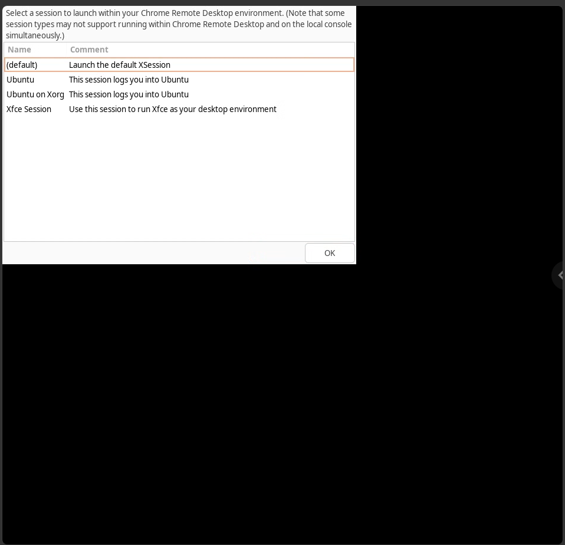

# chrome-remote-desktop-share-screen

[English](README.md)

리눅스용 크롬 원격 데스크톱(CRD)이 새 가상 화면을 띄우지 않고 **지금 모니터에 보이는 화면(`:0`)을 그대로 공유**하게 만드는 패치입니다.

- 테스트 환경: Ubuntu 24.04 · GNOME 46 (**Xorg** 세션) · GDM 자동 로그인 · CRD 155.0.8059.19

## 문제

리눅스용 CRD는 기본적으로 별도의 가상 X 화면(`:20`)을 만들고, 그 위에 데스크톱 세션을 하나 더 띄웁니다. 그래서 다음과 같은 일이 생깁니다.



- 검은 화면에 **세션 선택 창**(위 그림)이 뜹니다.
- *Ubuntu*를 고르면 같은 사용자의 GNOME이 두 번 실행되어 검은 화면이 나오거나 화면이 깨집니다.
- *Xfce*를 고르면 동작은 하지만, 평소에 쓰던 화면과는 다른 별개의 데스크톱이 뜹니다.

인터넷에 알려진 "`:0`에 붙이는" 수정 방법은 **최신 CRD에서 동작하지 않습니다.** 메인 루프가 X 서버 프로세스(`server_proc`)가 있을 때만 원격 호스트를 실행하기 때문입니다. X 서버를 띄우는 코드를 막으면 호스트가 아예 시작되지 않습니다.

## 패치 내용

`patch-crd.py`는 `/opt/google/chrome-remote-desktop/chrome-remote-desktop`을 다음과 같이 고칩니다.

1. 디스플레이 번호를 항상 `:0`으로 씁니다.
2. `launch_session()`이 새 화면을 만들지 않고 기존 화면에 붙습니다.
   - `DISPLAY`와 `XAUTHORITY`를 실제 화면에 맞춥니다.
   - 자동 로그인 세션이 뜰 때까지 기다립니다.
   - X 서버 자리에 가짜 프로세스(`sleep infinity`)를 넣어 호스트가 실행되게 합니다.

CRD를 종료하거나 재시작해도 이 가짜 프로세스만 종료되고, 실제 Xorg는 건드리지 않습니다.

## 설치

```bash
git clone https://github.com/bada0817/chrome-remote-desktop-share-screen.git
cd chrome-remote-desktop-share-screen
sudo bash install.sh
```

`install.sh`가 하는 일은 다음과 같습니다.

- CRD를 설치하거나 업데이트합니다.
- 패치를 적용합니다. 원본은 `chrome-remote-desktop.orig`로 백업됩니다.
- 패키지가 업데이트되면 패치를 자동으로 다시 적용하는 apt hook을 등록합니다.
- 이미 등록된 호스트가 있으면 서비스를 재시작합니다.

**처음 등록할 때**는 아무 브라우저에서 <https://remotedesktop.google.com/headless>를 열고 *Debian Linux* 명령어를 복사합니다. 그 명령어를 리눅스 PC에서 **sudo 없이** 실행하면 됩니다.

CRD가 이미 설치되어 있다면 패치만 따로 적용할 수도 있습니다.

```bash
sudo python3 patch-crd.py
sudo systemctl restart chrome-remote-desktop@$USER
```

## 주의

- **Xorg 세션이 필요합니다.** Wayland에서는 동작하지 않습니다. 최신 CRD의 "GDM-managed" 모드는 GNOME 49 이상 + Wayland 전용입니다.
- **"원격 데스크톱 크기 조정" 옵션은 끄세요.** 켜 두면 실제 모니터 해상도가 바뀔 수 있습니다.
- **원격 조작이 그대로 보입니다.** 원격으로 하는 작업이 실제 모니터에도 그대로 보입니다.
- **소리는 전달되지 않습니다.**
- **모니터 구성을 바꿔도 됩니다.** HDMI를 DP로 바꾸거나 모니터를 추가해도 그대로 동작합니다. `:0`은 모니터 번호가 아니라 X 디스플레이 번호이기 때문입니다.
- **Sunshine/Moonlight와 함께 써도 됩니다.**
- **CRD 업데이트 후** 세션 선택 창이 다시 보이면 `sudo systemctl restart chrome-remote-desktop@$USER`를 실행하세요.

## 제거

```bash
sudo bash uninstall.sh
```

원본 스크립트를 복원하고 apt hook을 삭제합니다. CRD 자체는 그대로 남습니다.

## 라이선스

[MIT](LICENSE). Google과 관계없는 비공식 패치입니다. 사용에 따른 책임은 사용자에게 있습니다.
